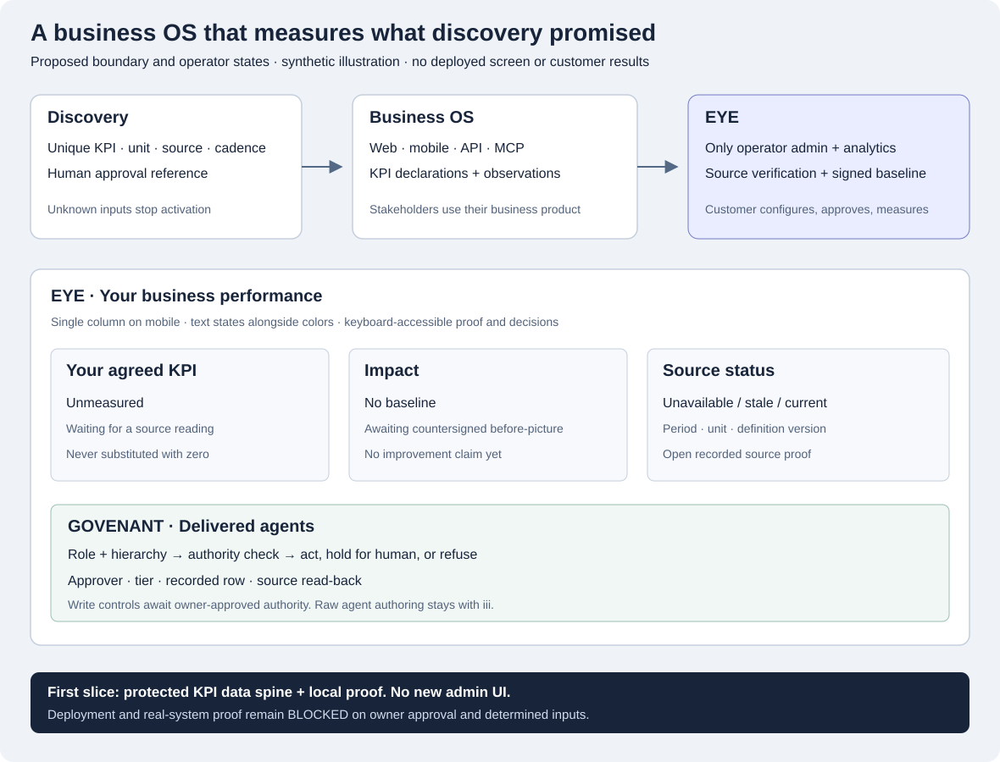
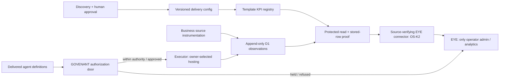
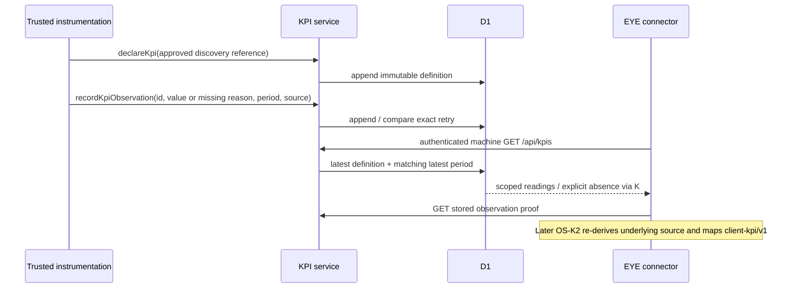
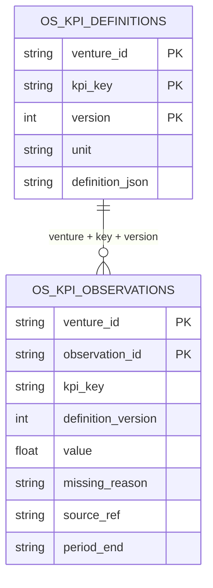

# Base AI-native business OS — review and delivery contract

Epic [#14](https://github.com/iii-Partners/viiibin-template-react/issues/14). Source reviewed at `ff6326b`, 2026-10-24. Verdict: **fit-with-changes**. The existing shell is a useful multi-surface substrate; it is not yet a business OS with a governed agent runtime and a KPI proof loop.

## Executive brief and customer narrative
Discovery can name the right business measures, but this template has no way to declare those measures or preserve readings. The operator therefore cannot reliably see whether delivered agents improve the business. Success means every declared KPI is sourced or explicitly unmeasured, every consequential act has an enforceable authority decision and recorded proof, and EYE reads the same contract across different deployments. These are acceptance goals, not measured customer results.

As a business operator, I open EYE, see the measures agreed in discovery, and follow a reading to its source. When no measurement or countersigned baseline exists, I see that absence rather than a zero or an improvement claim. I review held agent actions through EYE. My end users continue using my own web/mobile product; partners use my API/MCP. They do not see engineering tools. Agent authoring stays with iii. No new template admin dashboard is required.

This lane implements only OS-K1, the independent data spine. Later children implement sourced projection, governance and composition. Runtime hosting and customer authority are owner decisions, not engineering defaults. No deploy is authorized. The first slice does not claim business impact or verify an external signature merely because a reference string is present.

## Verified base and corrections to the brief
| Area | Evidence in this repo | Verdict / required change |
|---|---|---|
| Web surfaces | `src/app/router.tsx`: public landing/login/signup/legal; authenticated dashboard/items/profile/settings; lazy route seam | Suitable stakeholder shell. Dashboard is setup copy, not KPI reporting. |
| Mobile | `capacitor.config.ts`, `src/hooks/native/`, Capacitor 8 packages | Multi-surface capability exists; native binaries/devices were not built. README's Capacitor 7 claim is stale. |
| API + MCP | `functions/api/items*.ts`, `functions/mcp/index.ts` | Real CRUD and stateless MCP extension seams; neither is an agent executor. GET MCP discovery is public, tool calls protected. |
| Identity | `functions/_middleware.ts`, `src/app/providers.tsx` | Server verifies JWT or allowed machine key. Frontend guard can allow dev access when Auth0 absent; it is not backend authorization. Role permissions in `src/lib/auth/permissions.ts` are end-user app roles, not GOVENANT authority. |
| Data | `db/schema.ts`, `db/migrations/0000_initial.sql` | Only example items; no metric model, definition history, baseline, source adapter or decision ledger. |
| Agent runtime | `src/stores/chat.ts`, environment's AI_PROVIDER fields; no executor/roles/queue/tool-ceiling module | Chat state/config is not a runtime or proof of always-on operation. Runtime is net-new and hosting remains U1. |
| Telemetry | `functions/_lib/telemetry.ts`, `functions/api/health.ts`, browser consent module | Fleet envelope and delivery-status seam already exist. Acceptance and delivery are explicitly distinguished. Telemetry is not a KPI actual or external source proof. |
| Customization | `viiibin.config.json`, typed env, route/components/stores, Drizzle and Pages Functions | Strong code seams; no versioned client composition contract or ratified role/KPI pack yet. |
| Local dev | `dev/viiibin-pages-dev.ts` directly loads API handlers and proxies D1 | Useful sandbox adapter but bypasses Pages middleware. Use real Wrangler Pages for authorization proof. |

The app.iii constitution, capability matrix and append-only decision-ledger mechanisms are references to port, not deployed features here. In particular `motion_tier` means animation budget, **not agent autonomy**. The older governed-autonomy blueprint permits raw prompt/model editors; newer [EYE #1230](https://github.com/iii-Partners/iii-eye/issues/1230) keeps that authoring iii-side and takes precedence for this design.

## UX and visual contract


This SVG is a real proposed wireframe, not a shipped screen. EYE owns the operator view. On a narrow screen it becomes one column in the same order: KPI headline, source/status, held actions. EYE implementation belongs to #1250/#1251/#1258, not this repo.

| State | Observable experience | Owning verification |
|---|---|---|
| Loading | Read pending is identified; no cached figure attributed to another project | EYE #1250/#1251 browser tests |
| Empty/unmeasured | No declaration: no invented KPIs. Declared but unread: Unmeasured. NULL remains NULL. | OS-K1 contract/API tests |
| Unavailable/error | Source/query failure is unavailable, never successful empty data | OS-K1 API fault injection; OS-K2 source adapter |
| Stale | Last valid reading retains its period and stale marker; it is not presented as current | OS-K1 contract test |
| Success | Explicit unit, definition version, period and one-hop stored-row proof; only source-verified adapter can make a verified reading | OS-K1 row read-back; OS-K2 external re-derivation |
| Approval held | Human sees act, ceiling and reason in EYE; no execution until authorized decision is re-read | OS-G2; existing EYE #1253/#1258 |

EYE controls need keyboard operation, named states, focus after decisions, text alongside status colors and no raw SDK/repository fields. OS-K1 adds no interactive screen and therefore has API contract tests rather than a fabricated UI journey.

## Architecture decision: one deployment scope, one operator surface
Keep D1/Pages/React/Capacitor; add additive domain modules and migration. Use server-bound VENTURE_ID, never a venture parameter from the browser. Declarations and observations are versioned data; UI and authoring stay separate from execution. An immutable observation is evidence of what the source producer recorded, not proof that an arbitrary external query or approval really occurred. OS-K2 performs external source verification and EYE projection.





## Data and failure semantics (OS-K1)
`os_kpi_definitions`: composite `(venture_id, kpi_key, version)`, immutable definition JSON plus stable unit/category/direction columns. A change to the meaning of a stable KPI key is refused; create a new key instead. Version changes can update label/source/cadence with their discovery/approval references. A new version has no reading until that version is measured.

`os_kpi_observations`: unique `(venture_id, observation_id)`, foreign key to exact definition version, nullable finite value plus required missing reason for NULL, source reference, period and record timestamp. An internal append sequence breaks equal-period ties correctly even at the same timestamp. The producer chooses a stable id for retry; exact payload replay is harmless, conflicting reuse fails. Database triggers forbid UPDATE/DELETE/REPLACE, including paths that bypass application helpers. No baseline table or typed manual delta exists here.



Illustrative synthetic declaration (not customer facts):
```json
{"contract":"kpi-definition/v1","kpi_key":"queue_time","version":1,"label":"Queue time","unit":"hours","category":"cycle_time","better_is_lower":true,"discovery_ref":"synthetic:discovery:1","approval_ref":"synthetic:approval:1","source_ref":"synthetic:queue-query","max_age_seconds":86400}
```
`GET /api/kpis` returns `business-os-kpis/v1`; a stored-row read uses `?observation_id=<opaque-id>`. Public/end-user reads are refused; caller-supplied venture scope is rejected; missing deployment binding or storage is 503, unknown stored row 404, unsupported HTTP mutations 405. Handler responses are no-store. Every item says `source_verification: not_verified`: this service proves a stored observation, not its external source. Reads never declare or measure anything. Internal helpers accept no venture field and do not create an HTTP write path. Snapshot reads use one indexed query and refuse more than 100 distinct declarations explicitly rather than silently truncating.

Canonical EYE `client-kpi/v1` requires a finite number, source_ref and (for baseline) signed_ref. **Do not serialize the local snapshot as client-kpi/v1**: it also represents NULL/missingness and lacks a verified countersignature. EYE owns baseline ratification and impact math. OS-K2 maps only re-derived measurements, deduplicates observation ids, keeps demo out of customer/revenue reporting, and separates cost bases. Unknown currency cost is NULL with cost_reason, never zero.

Migration is additive and local-proof-only. Rollback disables consumers/reverts code while retaining append-only tables; do not drop or rewrite history. Production retention/erasure policy must be owner-ratified before activation. Store opaque operational references and aggregate numbers only; no patient/clinical data or free-form notes. No PHI leaves a tenant.

## Security, reliability and adversarial review
| Lens | Challenge | Resulting contract / remaining limit |
|---|---|---|
| Product/customer | A new analytics dashboard would create a second operator surface | Service API only; EYE owns UI. Unknown is visible, never a success metric. |
| UX/accessibility | Color-only health chips and loading zeros mislead | Explicit state text in proposed EYE view; no new product controls in this slice. |
| Architecture | CRUD/MCP/chat config mistaken for governed execution | Separate G1/G2/G3; no executor before U1; SDK wall reused from PR #16. |
| Data/API | Unit drift, stale periods and replay produce false impact | Closed schemas, database meaning guard, version join, latest period ordering and idempotency. No baseline/delta. |
| Security/privacy | Authenticated end user or tenant parameter leaks operator metrics | Machine-only handler after real Pages middleware; server venture binding; proof reads scoped too. Existing machine allowlist has no fine-grained scopes: keys are trusted deployment services, and scoped-key design remains future security work. |
| Integrity | Approval/source strings can be forged by a compromised producer | Presence is not ratification. No public write route. OS-K2 must re-derive; owner-approved activation required. This is not cryptographic external proof. |
| Reliability/performance | Empty success hides missing table; unbounded history reads become slow | 503 on storage errors; index by venture/key/version/period; snapshot reads only latest per declaration. Validate declaration-count/page budget before large production adoption. |
| QA/adversarial | A gate can pass without detecting a defect | Four new checks observed missing-artifact RED; planted working cn regression observed RED then restored GREEN; positive and negative SQL/API checks. No independent security sign-off claimed. |
| Delivery/cost | Existing red gates get quietly repaired or ignored | Preserve inherited lint and malformed ledger REDs; scoped blocks on #14; estimates use unknown cost with reason. |

This is one agent's multidisciplinary source review, not separate reviewer approvals. Performance targets, real discovery facts, signature resolution, hosting and authority policies are undetermined; no benchmark or customer result is invented.

## Delivery, regression and traceability
Reuse #14 as the tracking epic. [issues.json](issues.json) is the ordered map; every child has a customer product contract, engineering execution contract, Given/When/Then criteria, verification mapping and three-part estimate written before its build. OS-K1 → OS-K2; OS-G1 → OS-G2 → OS-G3; OS-K1 + OS-G1 → OS-C1. EYE's existing #1248/#1249/#1250/#1251/#1253/#1254/#1257/#1258 stay authoritative; this lane does not re-file them. Template PR #16 owns the SDK boundary.

The gate maps `os-issue-contracts`/`os-drawing` to M1; `os-kpi-contract`/`os-kpi-api` to M2; original lint/typecheck/build/tests to M3. Committed RED and mutation summaries live under `.loop/evidence/`, current logs under `.loop/artifacts/checks/`. Native/device builds, external EYE/PostHog/provider delivery and customer business source proof are outside local evidence. **I could not prove this against the real system.**

Possible regressions: machine auth affects API/MCP (#5); data migration must preserve items CRUD; telemetry (#8/#11) must continue distinguishing accepted/delivered; outbound flow (#7/#12) is untouched and not re-proved with absent providers. Existing unit suite, frontend build, functions typecheck and real middleware contract guard the shared paths. Every feature DoD: **does not break linked/dependent work**. Regression attribution follows git blame → PR → lane, with a named new regression test; no unlinked regression is acceptable.
